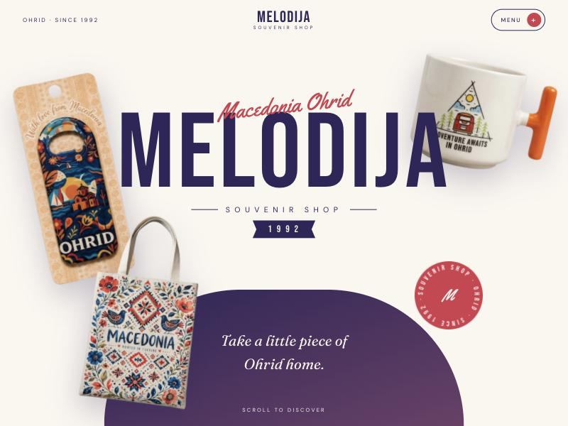

# Melodija — Custom WordPress Theme

A custom WordPress theme built from scratch for **Melodija Souvenir Shop**, a souvenir shop in Ohrid, North Macedonia.

**Live site:** [melodija-souvenirshop.rf.gd](https://melodija-souvenirshop.rf.gd)

## Features

- **Hand-coded theme**: PHP templates, HTML, CSS and vanilla JavaScript, with no page builder or parent theme
- **Editable product catalogue**: a custom post type (`melodija_product`) with a custom taxonomy for product tags, so products can be added, edited and reordered from WP Admin
- **Integrations**: Google Reviews, an Instagram feed and an embedded Google Map with a directions link
- **Responsive and accessible**: a mobile layout, a keyboard-friendly menu (focus management, `inert`, Escape to close), a skip link and `prefers-reduced-motion` support

## Tech stack

PHP · WordPress · HTML · CSS · JavaScript · LocalWP · Git

